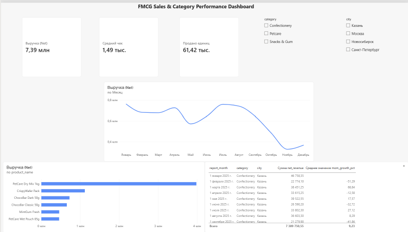

# FMCG Sales & Automation BI Pipeline

Сквозной пет-проект по автоматизации сбора, валидации, хранения и визуализации бизнес-отчётности для категории товаров повседневного спроса (FMCG).



## Стек технологий
* **ETL & Data Quality:** Python 3, Pandas, NumPy, SQLAlchemy
* **Хранилище и SQL-аналитика:** PostgreSQL 16 (Docker), схема «Звезда» (Star Schema), CTE, оконные функции (`LAG`, `RANK`), B-Tree индексы
* **BI и визуализация:** MS Power BI Desktop (Power Query, моделирование связей, DAX)

## Архитектура решения
1. **Extract & Transform (`src/etl_pipeline.py`):** извлечение сырых транзакций, автоматический аудит качества данных (удаление дубликатов по `order_id`, фильтрация пропусков и отрицательных значений), расчёт чистой и валовой выручки, нормализация данных в таблицы фактов (`fact_sales`) и измерений (`dim_products`, `dim_regions`).
2. **Load & SQL Views (`sql/analytical_views.sql`):** загрузка данных в PostgreSQL, построение аналитического представления `v_monthly_category_kpi` для расчёта MoM-динамики (Month-over-Month) и ранжирования регионов.
3. **Reporting (`bi/fmcg_dashboard.pbix`):** интерактивный дашборд в Power BI с динамической фильтрацией по категориям и городам, карточками KPI и анализом трендов.
4. **Documentation (`docs/DATA_DICTIONARY.md`):** описание структуры таблиц, правил валидации и формул расчёта метрик.

## Пример лога контроля качества данных (Data Quality Report)
```text
[INFO] DQ Report | Исходно: 5030 | Удалено дублей: 30 | Удалено аномалий: 55 | Итого валидных записей: 4945
[INFO] Загрузка в PostgreSQL завершена успешно.
